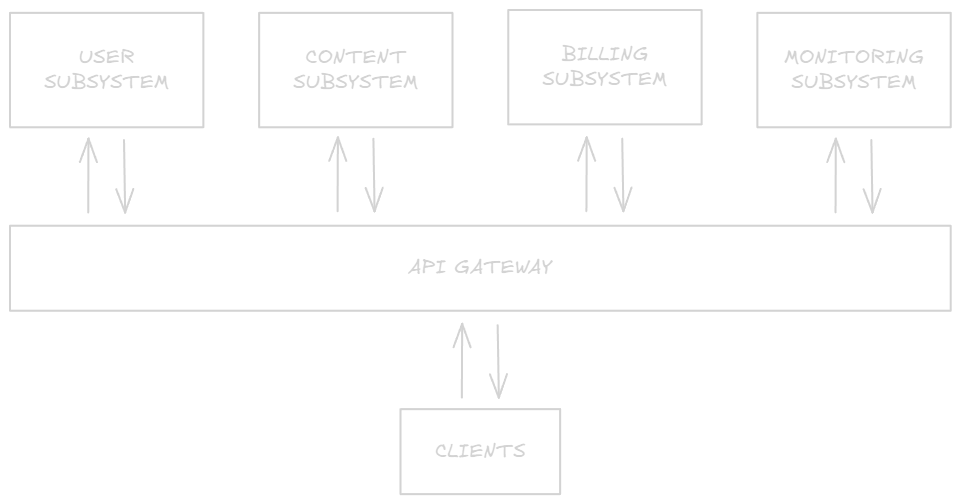
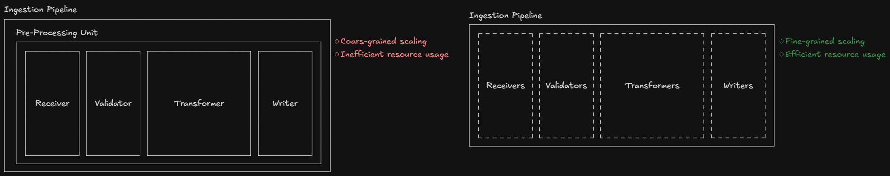
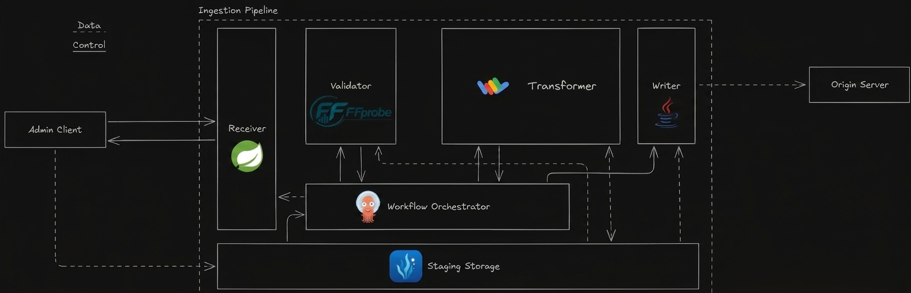

# System architecture

## Static description

### Subsystem view

Given the [domain-specific functional and non-functional requirements](../requirements.md#domain-specific-requirements), Crunchyroll Full-Stack Clone high-level **architecture** has been designed as **composition** of the following **four** **subsystems**, each addressing specific well-defined concerns.

1. **User Subsystem**: responsible for all the operations related to the **user**. From registration and login, to recommendations, and watchlists.
2. **Streaming Subsystem**: responsible for all the operations related to **video streaming**. Mainly storage, delivery, upload, and removal.
3. **Billing Subsystem**: responsible for all the operations related to **payments**. Notably subscriptions, and bills management.
4. **Monitoring Subsystem**: responsible for all the operations related to system **observability**. These include logging system behavior, in addition to monitoring utilization, and status of each single deployment node (Kafka with real-time data visualization).

The choice to build the system as a composition of units as independent as possible, has been made based on **two** **considerations**.

1. It keeps the high-level **architecture** simple, and so more **readable**.
2. It allows **independent** **development** and **maintenance** of single units.

### API Gateway

In addition to the subsystems mentioned above, the architecture also includes an API Gateway. It is used to **abstract** all the **backend** components from the client point-of-view by providing a single access-point. This increases system **security** and allows **load balancing**.

### Box-and-Line Diagram

A complete overview of the **high-level architecture** described so far is presented by the following **box and line** diagram.

### Low-Level architecture: from subsystems to components

Starting from the subsystems defined before, further refinements have been performed, leading to the definition of the following services in each subsystem.

### Streaming subsystem

#### Ingestion pipeline

All the [functional requirements of the ingestion pipeline](../../theory/README.md#ingestion-pipeline) are implemented using **four** main **classes** of **components**:

1. **Receivers**: responsible for receiving content upload requests, authenticating those requests, and granting writing permissions.
2. **Validators**: responsible for the verification of masters integrity and compliance of format and metadata.
3. **Transformers**: responsible for the transformation operations, from transcoding to encryption and manifest generation.
4. **Writers**: responsible for the writing of segments and manifests on the origin server.

These **classes** of components are not used to instantiate higher level units that handle the whole preparation process, instead they are treated as **four** completely different and **independent** **layers**. This provides the pipeline with **better scalability**, allowing only the specific components that need it to be scaled, and more **efficient jobs handling**, avoiding having allocated resources stuck doing nothing due to variations in the weight of the jobs.

The **coordination** of these four **layers** is **implemented** using an **orchestrator** of **ephemeral containers**. This allows, thanks to the orchestrator engine, to **automatically handle** **operations sequencing**, **components instantiation and deletion**, and **state tracking** for each job, providing the system with **intrinsic scalability**, **efficient resource allocation**, and **jobs state monitoring**.

Since the **receiver** has to be **always reachable**, it is the only component that is not handled by the orchestrator, and is instead **implemented** as a **permanent component**.

As for **communication**, the data transmission among the different layers is granted using an **object storage** as **staging**, due to the heaviness of the files being transferred.

An image showing the complete architecture is reported below, matching each component with its implementing technologies.

It is worth noting that this type of **architecture** for the ingestion pipeline **supports** both **horizontal** and **vertical** **scalability**, providing the system with both the possibility to **reduce** the **preparation time** for a single content and the possibility to **increase** the number of **contents** being **prepared** **concurrently**.

##### Step-by-step functioning

Given the architectural description provided above, the step-by-step functioning of the ingestion pipeline is as follows.

1. The Admin Client reaches the Receiver to upload new content.
2. The Receiver authenticates the Admin Client, grants it the writing permission for a path on the staging storage, and returns it a job ID to query the job state.
3. The Admin Client reaches the Staging Storage and starts the content upload.
4. When the upload is completed the Staging Storage notifies the Workflow Orchestrator that a new master is available.
5. The Workflow Orchestrator creates a Validator that reads the master from Staging Storage and checks for integrity and compliance.
6. If the validation is successful the Validator terminates and the Workflow Orchestrator creates a Transformer.
7. The Transformer proceeds to read the master from the Staging Storage, and process it to concurrently produce a set of different segmented, packaged and encrypted renditions.
8. When the transformation operations are completed the Transformer generates the manifest, writes all the results in the Staging Storage, and terminates.
9. The Workflow Orchestrator creates a Writer that reads the Staging Storage for the Transformer results, and writes the segments and the manifest in the Origin Server.

##### Implementation

The step-by-step discussion of the implementation of this component is available at [implementation-discussion](../implementation-discussion/)

### Users Interactions: Use-Case Diagram

## Dynamic Description

### Behavior: Sequence Diagrams
