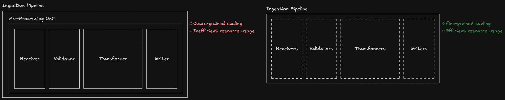
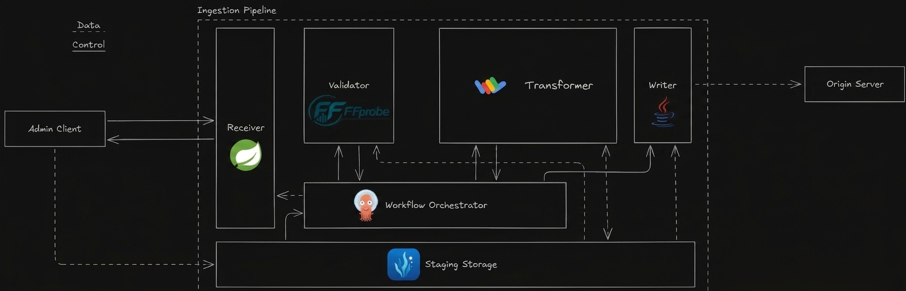

The idea and the **goal** of the **project**, as mentioned in the [project README](../README.md), is to **build** an **over-the-top video on-demand streaming system**. In order to do this it is firstly needed to understand the following basic concepts:

1. What is an over-the-top video on-demand streaming system
2. How does an over-the-top video on-demand streaming system work
3. How does an over-the-top video on-demand streaming system is implemented

All these topics are discussed in this **document** that covers **all** the **theoretical background** needed for the design and the implementation of the project.

## Streaming Systems

To **understand** what an **over-the-top video on-demand streaming system** is, and what are its goals, we firstly **need** to understand the definition and the goals of **streaming systems** **in general**. For this reason the first two sections of the document will focus on giving a broader view on streaming systems as a whole.  

### Definition: what is a streaming system

A streaming system is a system whose **goal** is to **produce**, **transmit**, and **consume** a **continuous**, and potentially **unbounded**, **stream** of **data** in an **incremental manner**.

_N.B. The **incremental handling** of these three operations is **crucial** in the definition of a streaming systems, since it makes them able to **solve** the **problems** they are **built for**._

### Motivation: why do streaming systems exist

The **existence** of streaming systems was made **necessary** by the need for the implementation of **two classes** of **real-world problems**:

1. **Problems** dealing with potentially **unbounded data**, in which **waiting** for the **complete availability** is **not possible** (e.g. monitoring problems and/or analytics problems).
2. **Problems** with **big data transfers** and **low-latency requirements**, in which **waiting** for the **complete availability** is **not desirable** (e.g any real-time problem).

The ideation of **streaming systems** has **allowed** to **deal with** these two classes of **problems** by **incrementally handling** the data **stream**. This incremental handling enables the computation of potentially unbounded streams of data in the first class of problems, and the lowering of latencies in the second class of problems.

### Over-the-top video on-demand streaming systems

**Over-the-top video on-demand streaming systems** are a **specific subclass** of streaming systems whose purpose is **allowing** **users** to **play** **video content** **whenever they want** with **low playback latency**. 

In over-the-top video on-demand streaming systems the **data stream** is **composed** by **multimedia data** (video), **transmitted** **upon** user's **request** (on-demand), **using** the **Internet infrastructure** as communication mean (over-the-top).

_N.B. Since the problem that these systems are trying to solve is mainly a latency problem, they belong to the **second class** of **streaming systems** mentioned earlier._

## Functioning: how do streaming systems work

### Anatomy: core components of streaming systems

As mentioned before, a streaming system is a system whose **purpose** is to **incrementally** **produce**, **transmit**, and **consume** a **data stream**. For this reason the **anatomy** of a generic streaming system is composed by **three** main **classes** of **components**:

1. **Producer**: incrementally produces the data stream.
2. **Broker**: incrementally transmits the data stream.
3. **Consumer**: incrementally consumes the data stream.

These **classes** are **logical representations**, and are then **instantiated** as **components** with more **specific characteristics** **based** on the **system** needs.

**Communication** instead is **mainly** implemented in **two ways**, **based** on the existing **relationship** between **data stream** and **consumers**:

1. **Publish-Subscribe**: in cases where the existence of the data stream is independent from consumers'requests (e.g. monitoring).
2. **Client-Server**: in cases where the existence of the data stream is dependent from consumers'requests (e.g. streaming on-demand).

It is also worth mentioning that the **broker** is **not always present** as a **stand-alone** component since there exist many streaming cases in which a distribution network and/or a layer of decoupling are not needed (e.g. point-to-point streaming).

#### Core components of over-the-top video on-demand streaming systems

Based on the anatomy of a generic streaming system discussed above, let's **introduce** the **specific anatomy** of an **over-the-top video on-demand streaming system**, bearing in mind that the **goal** of such a system is to **ingest**, **transmit**, and **consume** a **multimedia data stream**, so that users can access video content upon request with low latency.

Given this premise, the **logical components** described before are **instantiated** into **concrete components** with additional and more **specific** characteristics, designed expressly for the purpose of **over-the-top video on-demand streaming**.

Over-the-top video on-demand streaming systems will therefore consist of **three main concrete components**:

1. **Origin Server**: server that stores and emits, upon request, all the multimedia data of the system, working as **storage** and **producer**.
2. **Content-Delivery Network**: network of distributed servers that allows the data stream transmission over long distances with low latencies, the distribution of requests among different servers, and the caching of content on the edge servers, working as **broker**, **load-balancer**, and **cache**.
3. **Client**: client application that allows to request and playback the data stream, working as **interface** and **consumer**.

The **communication** between these three components is implemented, based on the distinction discussed above, as **client-server**, since the **data stream** has to be emitted **only** when a **consumer** makes a **request**.

With respect to other streaming domains, in which produced data can be directly streamed to the broker (e.g. monitoring), in the **video-streaming domain** we have to deal with **data** that **need** to **be prepared** before they can be served in streaming. The **ultra-high-quality video files** (masters) that systems in this domain have to handle are not suitable for streaming as they are. This is due to three main reasons:

1. **Extremely high bitrate**, that raises the streaming bandwidth needed to impractical levels.
2. Web players **not supported format**: that prevents the possibility to play those files using browsers.
3. Single **monolithic file**: that hinders the incremental transmission needed to produce the data stream, and prevents the usage of adaptive bitrate.

This raises the **need** to have a set of **pre-processing components** in addition to three main components discussed above. We will **refer** to this set of pre-processing components **as** **ingestion pipeline**.

_N.B. The separation between the ingestion pipeline and the origin server is important from a logical perspective, since the origin server is only meant to store data and emit streams, but it is maybe more important from a practical perspective, since it divides the workloads preventing an overload on the origin server._

Clearly an **over-the-top video on-demand streaming system** is **not** **solely** composed by the **elements** that are necessary to video **streaming**. It also consists of components that handle users, catalog, monitoring, optimization, and payments. However, the discussion of these components is secondary in describing specifically the functioning of streaming, and will therefore be carried out at a later moment.

For **now**, with the concrete components introduced, we first want to **define** the **domain-specific functionalities** that each one has to implement, to have **clear in mind** **what** they **have to do**. Then we want to **describe** in detail **how** each of these functionalities is **implemented**. Only in the end we will discuss the additional components that are not strictly related to streaming.

### Ingestion Pipeline

As just mentioned, in **over-the-top video on-demand streaming systems** **incoming data** **need** to be processed to be suitable for streaming. The operations that make masters ready for streaming are handled by a set of **pre-processing** components, that we called **ingestion pipeline**.

#### Functional requirements

In order to **make** the incoming multimedia **data** **available in streaming**, this pipeline has to support and perform **eight** different **operations**, that have **four** main **goals**.

1. **Compress masters** to lower bitrate versions that can be served via streaming.
2. **Encode** content in **multiple formats** and **bitrates** to allow playback on different players and to adjust the bitrate to the available bandwidth.
3. **Split** single **monolithic files** into **singularly retrievable segments** to enable incremental transmission, jumping at any point, and quality-switching at the end of any segment.
4. **Encrypt contents** to guarantee security during transport and consumption.

These eight operations needed by the ingestion pipeline to prepare masters to their streaming distribution are the following.

1. **Ingestion**: it has to be able to receive ultra-high-quality masters using an upload system that supports extremely large files.
2. **Validation**: it has to be able to verify files integrity and to validate format and metadata, to immediately reject any corrupted file or non-compliant requests.
3. **Transcoding**: it has to be able to recode contents into multiple versions with increasing bitrate, each in different formats compatible with the different web players.
4. **Segmentation**: it has to be able to split all the versions produced during transcoding into singularly retrievable segments of 2-10 seconds.
5. **Packaging**: it has to be able to package all the segments into containers compatible with the different streaming protocols.
6. **Encryption**: it has to be able to encrypt all the segments and enable the mechanism to request the keys.
7. **Manifest generation**: it has to be able to generate a document for each content describing available versions, segments' location, available audio and subtitles tracks, and their location, to allow clients to know the available versions for each content and the information needed to retrieve them.
8. **Writing**: it has to be able to communicate with the storage (the origin server) to write segments, metadata, version identifiers, and manifests, writing the manifest as last element so to make available to the clients only contents for which the writing process was successful.

#### Architecture

All these **functional requirements** are **implemented** in the ingestion pipeline using **four** main **classes** of **components**:

1. **Receivers**: responsible for receiving content upload requests, authenticating those requests, and granting writing permissions.
2. **Validators**: responsible for the verification of masters integrity and compliance of format and metadata.
3. **Transformers**: responsible for the transformation operations, from transcoding to encryption and manifest generation.
4. **Writers**: responsible for the writing of segments and manifests on the origin server.

These **classes** of components are not used to instantiate higher level units that handle the whole preparation process, instead they are treated as **four** completely different and **independent** **layers**. This provides the pipeline with **better scalability**, allowing only the specific components that need it to be scaled, and more **efficient jobs handling**, avoiding having allocated resources stuck doing nothing due to variations in the weight of the jobs.

The **coordination** of these four **layers** is **implemented** using an **orchestrator** of **ephemeral containers**. This allows, thanks to the orchestrator engine, to **automatically handle** **operations sequencing**, **components instantiation and deletion**, and **state tracking** for each job, providing the system with **intrinsic scalability**, **efficient resource allocation**, and **jobs state monitoring**.

Since the **receiver** has to be **always reachable**, it is the only component that is not handled by the orchestrator, and is instead **implemented** as a **permanent component**.

As for **communication**, the data transmission among the different layers is granted using an **object storage** as **staging**, due to the heaviness of the files being transferred.

An image showing the complete architecture is reported below, matching each component with its implementing technologies.

It is worth noting that this type of **architecture** for the ingestion pipeline **supports** both **horizontal** and **vertical** **scalability**, providing the system with both the possibility to **reduce** the **preparation time** for a single content and the possibility to **increase** the number of **contents** being **prepared** **concurrently**.

#### Step-by-step functioning

Given the architectural description provided above, the step-by-step functioning of the ingestion pipeline is as follows.

1. The Admin Client reaches the Receiver to upload new content.
2. The Receiver authenticates the Admin Client, grants it the writing permission for a path on the staging storage, and returns it a job ID to query the job state.
3. The Admin Client reaches the Staging Storage and starts the content upload.
4. When the upload is completed the Staging Storage notifies the Workflow Orchestrator that a new master is available.
5. The Workflow Orchestrator creates a Validator that reads the master from Staging Storage and checks for integrity and compliance.
6. If the validation is successful the Validator terminates and the Workflow Orchestrator creates a Transformer.
7. The Transformer proceeds to read the master from the Staging Storage, and process it to concurrently produce a set of different segmented, packaged and encrypted renditions.
8. When the transformation operations are completed the Transformer generates the manifest, writes all the results in the Staging Storage, and terminates.
9. The Workflow Orchestrator creates a Writer that reads the Staging Storage for the Transformer results, and writes the segments and the manifest in the Origin Server.

#### Implementation

### Origin Server

As previously mentioned, in an over-the-top video on-demand streaming system the **origin server** works as **storage** for all multimedia data, and as **producer** of all the requested data streams. **Therefore** the **domain-specific functionalities** that this component has to support in addition to its responsibilities as a producer are the following:

1. **Capability** to **store multimedia data** in **multiple formats** **ready** for the **streaming**: necessary to offer streaming to the users, even with changes in the requested format or quality.
2. **Capability** to **receive** and **store** **new multimedia data** for the **streaming**: necessary to allow the system to have an always up-to-date catalog.
3. **Capability** to **mark** each **content** with a **version identifier**: necessary for the implementation of caching mechanisms.
4. **Capability** to **serve** **multiple nodes** of the content-delivery network **concurrently**: necessary to handle the volume of users that a streaming system aims to serve.

In **addition** to those functionalities, an origin server **has** also to **support** the following non-functional requirements, required for the system to function properly:

1. **Performance**: needed in multimedia data access and transmission to provide a low-latency service.
2. **Scalability**: needed in multimedia data storage, given the enormous quantity of data that the system has to store, due to the necessity to store each content in multiple formats.
3. **Security**: needed in multimedia data access and transmission to ensure that these are only available to the system infrastructure.
4. **Redundancy**: needed to ensure system availability and to prevent multimedia data loss.

The **implementation** of domain-specific functionalities and non-functional requirements, along with the incremental production of data streams inherent to the role of producer that this component plays, is discussed functionality by functionality in the **following sections**. 

#### Storing multimedia data in multiple formats ready for the streaming

### Content Delivery Network (spiegazione content delivery networks)

#### Domain Name System

### Client

### Completing components of over-the-top video on-demand streaming systems

## Implementation (spiegazione implementazione)